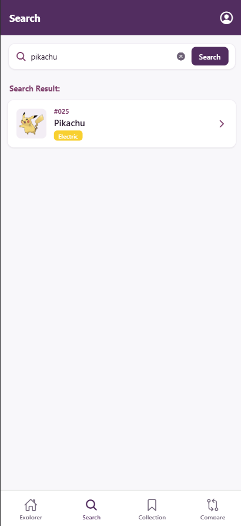
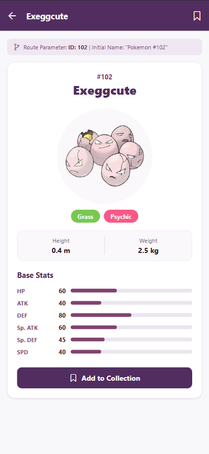
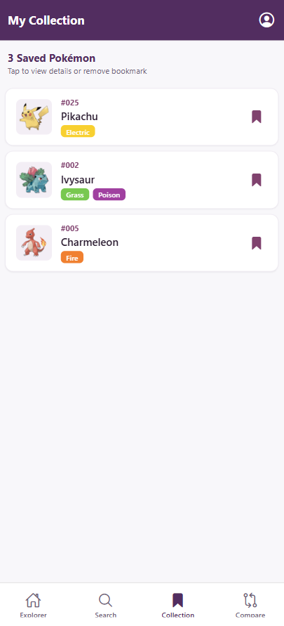
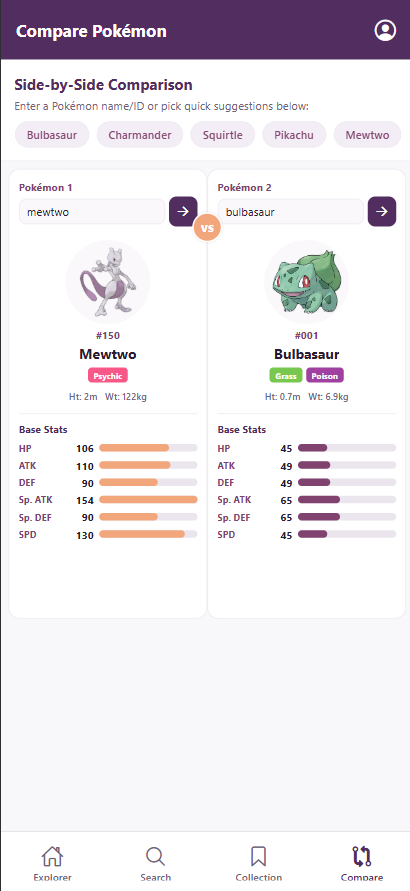
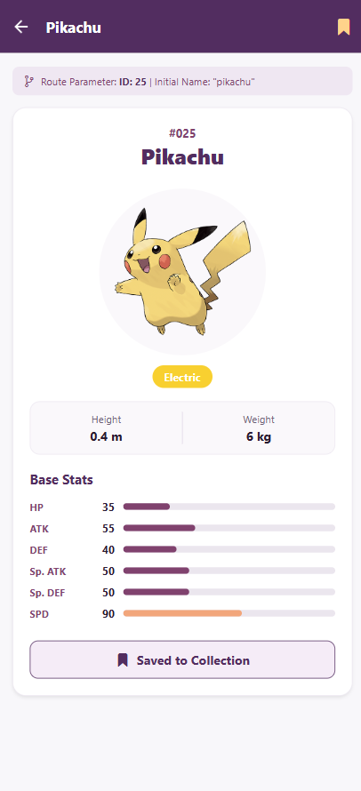
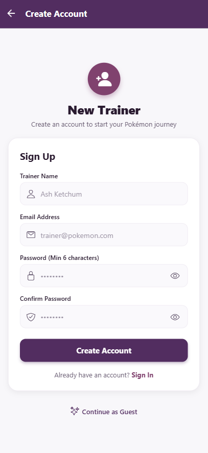

# PokéTinder

A React Native mobile application built with Expo featuring Firebase Authentication, PokéAPI integration, Pokémon search and comparison, and shared collection state.

---

## 🚀 Quick Start

### 1. Install Dependencies
```bash
npm install
```

### 2. Start the Development Server
```bash
npx expo start
```

Press:
- `a` to open on Android Emulator / Device
- `i` to open on iOS Simulator
- `w` to open in Web Browser
- Or scan the QR code with **Expo Go** on your physical mobile phone

## ✅ Continuous Integration

GitHub Actions runs on pull requests targeting `main`, pushes to `main`, and manual runs from the repository's **Actions** tab. It installs dependencies with `npm ci` and exports the web app with Expo to verify the project builds. This workflow only checks the build; it does not deploy or publish the app.

## 📸 Screenshots

| Search | Pokémon details |
|---|---|
|  |  |

| Collection | Pokémon comparison |
|---|---|
|  |  |

| Bookmarked Pokémon | Sign-up |
|---|---|
|  |  |

## 🔥 Firebase Setup

The app uses Firebase Authentication for email/password sign-up and sign-in. It also offers a guest option, which keeps the current session in app state but does not create a Firebase account.

1. Create a Firebase project and register an app in the Firebase Console.
2. Enable **Authentication → Sign-in method → Email/Password**.
3. Add the Firebase web app configuration to a project-root `.env` file:

   ```env
   EXPO_PUBLIC_FIREBASE_API_KEY=your-api-key
   EXPO_PUBLIC_FIREBASE_AUTH_DOMAIN=your-project.firebaseapp.com
   EXPO_PUBLIC_FIREBASE_PROJECT_ID=your-project-id
   EXPO_PUBLIC_FIREBASE_STORAGE_BUCKET=your-project.appspot.com
   EXPO_PUBLIC_FIREBASE_MESSAGING_SENDER_ID=your-sender-id
   EXPO_PUBLIC_FIREBASE_APP_ID=your-app-id
   EXPO_PUBLIC_FIREBASE_MEASUREMENT_ID=your-measurement-id
   ```

   These variable names are read in [src/config/firebase.js](./src/config/firebase.js). The `.env` file is ignored by Git; do not commit your local copy.
4. Restart Expo after changing environment variables:

   ```bash
   npx expo start
   ```

   Expo substitutes `EXPO_PUBLIC_` variables into the client bundle. Firebase client configuration is therefore visible in the app and is not a place for private secrets. Secure Firebase services with appropriate Firebase Security Rules.

### Authentication and storage

- On iOS and Android, Firebase Authentication uses `@react-native-async-storage/async-storage` through Firebase's React Native persistence adapter, so a signed-in Firebase user remains signed in after restarting the app.
- On web, Firebase Authentication uses its browser persistence.
- Guest access is held in React state only and does not persist after an app restart.
- Firestore is initialized in the Firebase configuration, but the current app does not yet read or write Firestore data.

---

## 📱 Navigation Architecture

The app uses a **Bottom Tab Navigator** nested inside a **Native Stack Navigator**. The stack shows the login/sign-up flow when signed out, and the explorer tabs, Pokémon details, and trainer profile after sign-in or continuing as a guest.

```
Stack Navigator (AppNavigator)
├── Signed out
│   ├── Login
│   └── Signup
└── Signed in or guest
    ├── MainTabs (Bottom Tab Navigator)
    │   ├── Home ("PokéTinder")
    │   ├── Search ("Search")
    │   ├── Collection ("My Collection")
    │   └── Compare ("Compare Pokémon")
    ├── PokemonDetails (dynamic title & bookmark toggle)
    └── Profile
```

### Navigation Configuration Files:
- [src/navigation/AppNavigator.js](./src/navigation/AppNavigator.js): Configures the auth flow and signed-in stack routes.
- [src/navigation/TabNavigator.js](./src/navigation/TabNavigator.js): Configures the Bottom Tabs (`Home`, `Search`, `Collection`, `Compare`).
- [src/context/AuthContext.js](./src/context/AuthContext.js): Provides authentication, guest access, and auth state to the app.
- [src/config/firebase.js](./src/config/firebase.js): Initializes Firebase Auth and Firestore.

---

## 🎨 Color Palette

Adheres strictly to the assignment specification:

| Role | Color Hex | Color RGB | Usage |
|---|---|---|---|
| **Primary** | `#522D60` | `rgb(82, 45, 96)` | Navigation bars, main headers, primary buttons |
| **Secondary** | `#80426E` | `rgb(128, 66, 110)` | Supporting UI, badges, secondary actions |
| **Warm Accent** | `#F2A67B` | `rgb(242, 166, 123)` | Stat bars, VS badge, highlights |
| **Highlight** | `#FFD38B` | `rgb(255, 211, 139)` | Star/bookmark icons, active indicators |

Tokens defined in: [src/constants/theme.js](./src/constants/theme.js)

---

## 📋 Viva Demonstration Checklist

| # | Checklist Item | How it is Demonstrated | File Reference |
|---|---|---|---|
| **1** | **Header button with meaningful action** | Tap the **"Random 🎲"** button in the Home screen header. It generates a random Pokémon ID (1–151) and navigates to its Details screen. | [src/screens/HomeScreen.js](./src/screens/HomeScreen.js) |
| **2** | **Route parameters & displaying them** | Tap a Pokémon from Search (or Home). The Details screen reads the Pokémon ID and name from route parameters and fetches its data from PokéAPI. | [src/screens/DetailsScreen.js](./src/screens/DetailsScreen.js) |
| **3** | **Bookmark synchronization** | Bookmark a Pokémon and switch to the **Collection** tab to see it synced via `CollectionContext`. | [src/screens/CollectionScreen.js](./src/screens/CollectionScreen.js), [src/context/CollectionContext.js](./src/context/CollectionContext.js) |
| **4** | **Split-screen Compare** | Open the **Compare** tab for a side-by-side comparison of two Pokémon, including sprites, types, height, weight, and base stats. | [src/screens/CompareScreen.js](./src/screens/CompareScreen.js) |
| **5** | **Customized headers & navigator structure** | Explain the auth flow, stack navigator, and bottom tabs. The profile screen is accessible from the tab headers. | [src/navigation/AppNavigator.js](./src/navigation/AppNavigator.js), [src/navigation/TabNavigator.js](./src/navigation/TabNavigator.js) |

---

## 📂 Project Directory Structure

```
├── App.js                      # Root component with Providers and Navigation
├── app.json                    # Expo project configuration
├── package.json                # Project dependencies and scripts
├── .env                        # Local Firebase client config (ignored by Git)
├── src/
│   ├── api/
│   │   └── pokeapi.js          # PokéAPI fetch functions and helpers
│   ├── config/
│   │   └── firebase.js         # Firebase Auth, Firestore, and env config
│   ├── constants/
│   │   └── theme.js            # Color palette tokens and Pokémon type colors
│   ├── context/
│   │   ├── CollectionContext.js# Shared in-memory bookmark state
│   │   └── AuthContext.js      # Firebase auth and guest session state
│   ├── components/
│   │   ├── PokemonCard.js      # Reusable card component for grid display
│   │   ├── PokemonRow.js       # Reusable row item for lists/search
│   │   ├── StatBar.js          # Reusable stat progress bar
│   │   ├── LoadingView.js      # Loading indicator with message
│   │   └── ErrorView.js        # Error message with retry action
│   ├── navigation/
│   │   ├── AppNavigator.js     # Native Stack Navigator (MainTabs + Details)
│   │   └── TabNavigator.js     # Bottom Tab Navigator (Home, Search, Collection, Compare)
│   └── screens/
│       ├── LoginScreen.js      # Email/password login and guest entry
│       ├── SignupScreen.js     # Email/password account creation
│       ├── HomeScreen.js       # Explorer grid with Random header button
│       ├── SearchScreen.js     # Search by name or ID with quick suggestions
│       ├── CollectionScreen.js # Saved bookmarks list
│       ├── CompareScreen.js    # Side-by-side split comparison screen
│       ├── DetailsScreen.js    # Full Pokémon details with route params & bookmark action
│       └── ProfileScreen.js    # Trainer profile and sign-out
```
